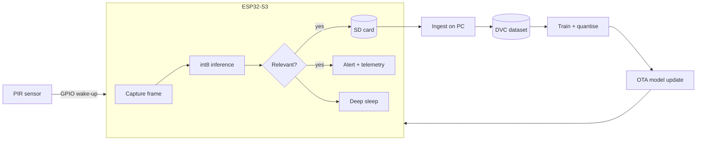

# esp32-edge-mlops

A battery-friendly camera trap that runs a quantised neural network **on an
ESP32-S3**, built as a complete MLOps loop: data collection on the device,
versioned datasets, training and int8 quantisation on a PC, over-the-air model
updates with rollback, and on-device monitoring for drift.

The goal is not the classifier itself, it is the full lifecycle of a model
running on a microcontroller, with every trade-off measured.

> **Status:** M0 (board bring-up) — firmware written, waiting for first flash.
> See [docs/ROADMAP.md](docs/ROADMAP.md).

## How it works



Details: [docs/ARCHITECTURE.md](docs/ARCHITECTURE.md).

## Results

Filled in as milestones land. Every number comes from a measurement on the
real board, with the method described in `docs/`.

| Metric | Value | Milestone |
|---|---|---|
| Accuracy, float32 model (PC) | — | M3 |
| Accuracy, int8 model (PC) | — | M3 |
| Accuracy, int8 model (on device) | — | M4 |
| Inference latency on ESP32-S3 | — | M4 |
| Model size (flash) / tensor arena (RAM) | — | M4 |
| Wake → decision time | — | M4 |
| Deep-sleep current | — | M4 |
| OTA update time / rollback verified | — | M5 |

## Repository layout

```
firmware/   ESP-IDF project for the ESP32-S3
training/   dataset tooling, training and quantisation (Python)
docs/       architecture, roadmap, decision records, hardware notes
.github/    CI: firmware build on every push
```

## Hardware

Freenove ESP32-S3-WROOM CAM (ESP32-S3, 8 MB flash, 8 MB octal PSRAM, OV2640
camera, microSD slot) and a mini PIR sensor. Wiring and pin choices:
[docs/HARDWARE.md](docs/HARDWARE.md).

## Build and flash

Requires ESP-IDF v5.5 or newer (the VS Code extension is the easiest install
on Windows).

```bash
cd firmware
idf.py set-target esp32s3
idf.py build
idf.py -p COMx flash monitor   # COMx on Windows, /dev/ttyUSB0 on Linux
```
