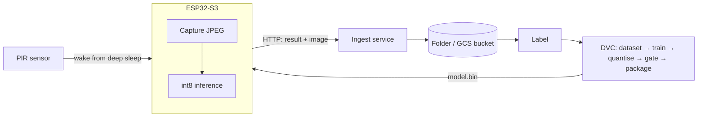

# esp32-edge-mlops

A motion-triggered camera that runs a quantised neural network **on an
ESP32-S3**, built as a complete MLOps loop: captures uploaded over Wi-Fi,
versioned datasets, training and int8 quantisation with an evaluation gate,
model packages validated on the device, and on-device results reported back
for monitoring.

The goal is not the classifier itself, it is the full lifecycle of a model
running on a microcontroller, with every trade-off measured.

> **Status:** firmware, ingest service and training pipeline written and
> verified without hardware (compiler, unit tests, ESP32-S3 emulator). First
> boot on the board done with ESP-IDF v6.1 (M0 passed). Next: capture and
> upload on the board (M1). See [docs/ROADMAP.md](docs/ROADMAP.md).

## How it works



Details: [docs/ARCHITECTURE.md](docs/ARCHITECTURE.md) ·
protocol: [docs/PROTOCOL.md](docs/PROTOCOL.md) ·
model package: [docs/MODEL_PACKAGE.md](docs/MODEL_PACKAGE.md) ·
decisions: [docs/adr/](docs/adr/)

## Results

### Measured so far (no board yet)

| What | Value | How |
|---|---|---|
| Firmware image, collect / infer mode | 1.0 MB / 1.2 MB of a 2.5 MB slot | ESP-IDF v5.5 build |
| Model size / parameters | 23.9 KB / 7.5 k | int8 TFLite, current architecture |
| Tensor arena used | 41 KB | firmware in the emulator |
| Device vs PC, same model and images | same class on 3/3; outputs within 1 int8 step | `tools/qemu_bench.sh` |
| Device vs PC preprocessing | ≤ 2 grey levels per pixel (mean 0.45) | same run |
| Corrupted model package | refused (SHA-256 mismatch), device keeps working | same run, one byte changed |
| Automated tests | 77 (training 50, server 27) | `pytest` |

### Measured on the board (ESP-IDF v6.1, 2026-11-17)

| What | Value | How |
|---|---|---|
| Board self-test | `M0 RESULT: PASS`: 8 MB flash, 8 MB octal PSRAM, 1 MB PSRAM test | serial log, collect mode |
| Camera | OV3660 detected; 1024×768 JPEG, ~19 KB, init 362 ms + grab 620 ms | same |
| Model package on the device | synthetic model loaded after SHA-256 check; arena 82 of 512 KB | infer mode, `edgeml.smoke` package |
| One inference | JPEG decode 70.5 ms, invoke 26.5 ms | same, one frame |
| Corrupted model package | refused (SHA-256 mismatch), device keeps working | same, last byte flipped |

These are single runs and the model is still the synthetic one, so the
classification it prints means nothing yet.

The model behind these numbers was trained on **synthetic** images (drawn
shapes) to exercise the pipeline. It proves the plumbing, not the accuracy.

### To be measured on the board

| Metric | Value | Milestone |
|---|---|---|
| Accuracy, float32 / int8 (real test set) | — | M3 |
| Inference latency on ESP32-S3 (ESP-NN kernels) | — | M4 |
| Wake → decision / wake → uploaded | — | M1 / M4 |
| Deep-sleep current | — | M6 |
| OTA update time, rollback verified | — | M5 |

## Repository layout

```
firmware/   ESP-IDF project for the ESP32-S3 (components/, main/, partitions.csv)
server/     ingest service (FastAPI) + Dockerfile for the cloud
training/   edgeml package: ingest, dataset, train, quantise, package; DVC pipeline
tools/      device simulator, emulator bench, metadata check
docs/       architecture, protocol, model package, hardware, roadmap, ADRs
```

## Quick start

### 1. Run the ingest service on the PC

```bash
cd server
pip install -r requirements.txt
INGEST_TOKEN=change-me INGEST_STORAGE=local:./data uvicorn ingest_service.app:app --host 0.0.0.0 --port 8000
```

On Windows PowerShell set the variables with `$env:INGEST_TOKEN="change-me"`
first. Check it from another terminal:

```bash
python tools/fake_device.py --url http://localhost:8000/v1/events --token change-me --count 3
```

### 2. Build and flash the firmware

Requires ESP-IDF v5.5 or v6.1 (the VS Code extension is the easiest install on
Windows). CI builds with v5.5; the board was validated with v6.1.

```bash
cd firmware
idf.py set-target esp32s3
idf.py menuconfig        # Uplink: Wi-Fi SSID/password, ingest URL (http://<PC IP>:8000/v1/events), token
idf.py build
idf.py -p COMx flash monitor
```

Wi-Fi credentials end up in `firmware/sdkconfig`, which git ignores. Use the
board's **UART** USB port. Wiring: [docs/HARDWARE.md](docs/HARDWARE.md).

Infer mode: `idf.py -D SDKCONFIG_DEFAULTS="sdkconfig.defaults;sdkconfig.infer" build`
(delete `sdkconfig` first when switching modes).

### 3. Data → model

```bash
cd training
pip install -r requirements.txt
python -m edgeml.ingest --store ../server/data --raw data/raw   # new captures → data/raw/unlabeled
# label: move images (with their .json) into data/raw/{nothing,person,animal}/
dvc add data/raw                                                # snapshot this version of the dataset
dvc repro                                                       # dataset → train → quantise → package
parttool.py --port COMx write_partition --partition-name model --input models/model.bin
```

### 4. Checks that need no board

```bash
cd training && pytest -m "not slow"          # unit tests, C/Python parity
cd server && pytest
python -m edgeml.smoke --out /tmp/smoke      # whole pipeline on synthetic images
tools/qemu_bench.sh /tmp/smoke/models/model.bin   # firmware in the emulator vs the PC
```
