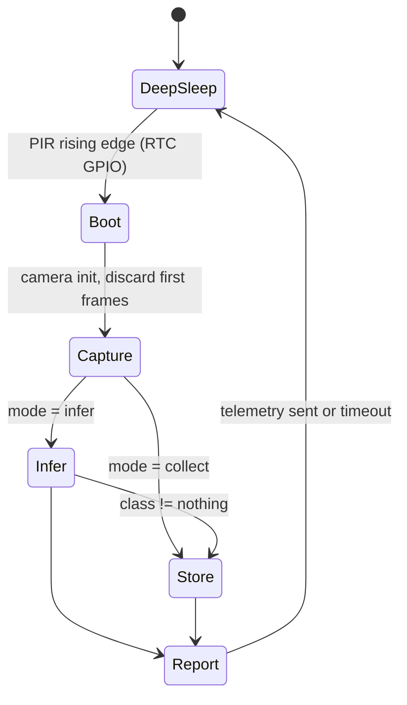
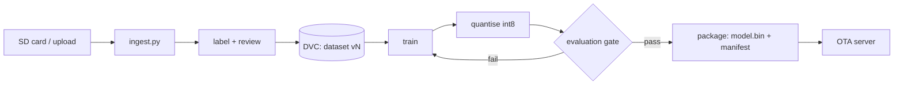

# Architecture

## Goals and constraints

The system classifies what triggered a motion sensor (person, animal, nothing)
directly on an ESP32-S3, and keeps improving the model through a repeatable
data → train → deploy → monitor loop.

| Constraint | Consequence |
|---|---|
| ~512 KB internal SRAM, 8 MB PSRAM | Small CNN, int8 weights, tensor arena in PSRAM |
| 8 MB flash shared by two firmware slots and the model | Model gets its own partition (ADR 0002) |
| Battery operation is the target | Device sleeps by default; every wake-up has a time budget |
| Mistakes in the field must be recoverable | OTA with automatic rollback, model validated before use |

## Device

### Operating modes

* **Collect** — every PIR event is captured and saved to the SD card with
  metadata. Used to build the dataset (M1–M2).
* **Infer** — every PIR event runs the model; only relevant events are stored
  and reported (M4 onwards).

### Event cycle

Every transition is timed with `esp_timer_get_time()` so the wake → decision
budget can be measured and reported (README results table).

### Firmware modules

| Module | Responsibility | Milestone |
|---|---|---|
| `board` | Pin map, chip/memory self-test | M0 |
| `power` | Deep sleep, wake-up source, wake reason | M1 |
| `camera` | OV2640 init, frame capture, resize/greyscale for the model | M1 |
| `storage` | SD card (FAT), capture files + JSON sidecar metadata | M1 |
| `inference` | Load model from flash partition, validate, run, return scores | M4 |
| `telemetry` | Event record (model version, scores, latency) over Wi-Fi/MQTT | M6 |
| `ota` | Download and switch firmware or model, rollback on failure | M5 |

### Flash layout (8 MB)

Defined in [`firmware/partitions.csv`](../firmware/partitions.csv).

| Partition | Type | Size | Purpose |
|---|---|---|---|
| nvs | data | 24 KB | Settings, counters |
| otadata | data | 8 KB | Which app slot is active |
| phy_init | data | 4 KB | RF calibration |
| ota_0 | app | 2.5 MB | Firmware slot A |
| ota_1 | app | 2.5 MB | Firmware slot B |
| model | custom (0x40) | 2 MB | Quantised model + manifest |

## Host side (PC)

* **Dataset versioning** — DVC tracks images and labels; git tracks the DVC
  pointers, so every model can be traced back to the exact data it saw.
* **Evaluation gate** — a model is only packaged if the int8 version stays
  within a fixed accuracy drop of the float version and fits the size budget.
* **Model package** — the binary is preceded by a manifest (magic, format
  version, model version, input shape, labels, SHA-256). The firmware refuses
  a model whose manifest or checksum does not match.

## Monitoring

Each event reports: model version, top-1 class and confidence, latency, wake
reason and supply voltage. On the PC, a rolling comparison of class distribution
and mean confidence against the training set flags drift (for example, lighting
changes). Drifted events are pulled into the next dataset version.

## Decisions

Recorded in [`docs/adr/`](adr/):

* [0001 — ESP-IDF instead of Arduino](adr/0001-esp-idf-over-arduino.md)
* [0002 — Model in its own flash partition](adr/0002-model-in-dedicated-partition.md)
* [0003 — Inference runtime: TFLite Micro vs ESP-DL](adr/0003-inference-runtime.md)
