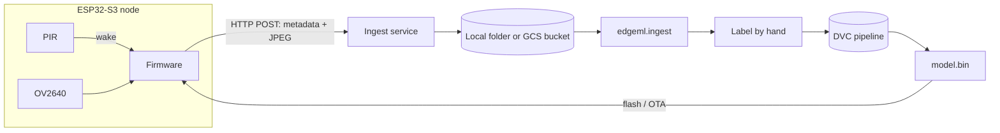
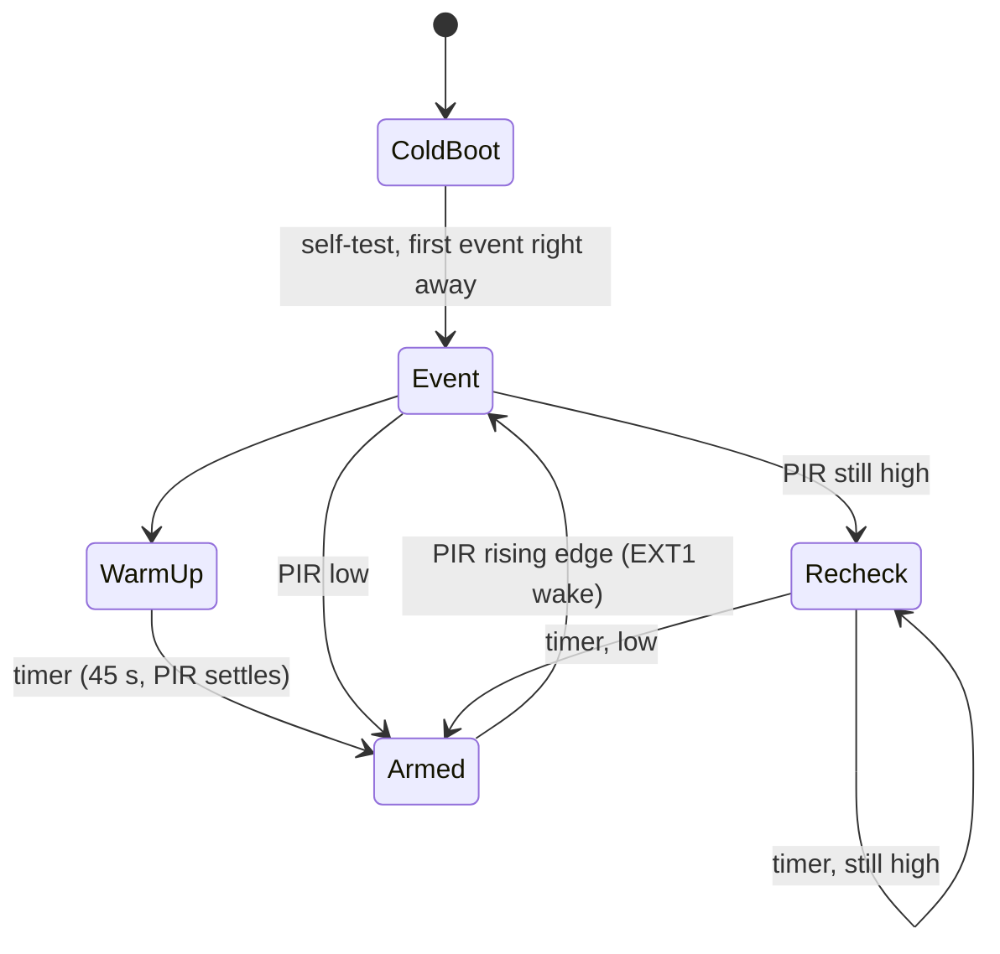
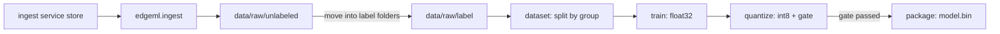

# Architecture

## Goals and constraints

The system classifies what triggered a motion sensor (person, animal, nothing)
directly on an ESP32-S3, and keeps improving the model through a repeatable
data → train → deploy → monitor loop.

| Constraint | Consequence |
|---|---|
| ~512 KB internal SRAM, 8 MB PSRAM | Small CNN, int8 weights, tensor arena and frame buffer in PSRAM |
| 8 MB flash shared by two firmware slots and the model | Model gets its own partition (ADR 0002) |
| Battery operation is the target | Device sleeps by default; every wake-up is timed |
| Mistakes in the field must be recoverable | Model validated before use; OTA with rollback (M5) |

## System

| Part | Code | Notes |
|---|---|---|
| Firmware | `firmware/` | ESP-IDF, one component per concern |
| Ingest service | `server/` | FastAPI; storage backend chosen by configuration (ADR 0004) |
| Training pipeline | `training/` | Python package `edgeml`, stages wired by DVC |
| Tools | `tools/` | Device simulator, emulator bench, protocol check |

## Device

### Operating modes (`idf.py menuconfig` → Application)

* **Collect** — every PIR event is captured and uploaded. Used to build the dataset.
* **Infer** — the model runs on every event. The image is uploaded only if the
  result is not "nothing", the confidence is low, or the event is in the
  periodic sample used to watch for drift; the result is always reported.
* **Bench** — no camera, sensor or network: runs the model on three JPEGs built
  into the firmware and prints machine-readable results. Used in the emulator
  and on the board to measure latency and check device-versus-PC agreement.

### Event cycle

Each box is a separate boot: the chip is in deep sleep between them, and the
only state carried across is a small struct in RTC memory (session id, event
counter, upload failures). "Recheck" avoids an immediate re-wake while the PIR
holds its output high after an event.

Inside **Event**, Wi-Fi association is started first so it overlaps with the
camera start-up; then: capture → (infer) → upload → sleep. Every stage is
timed and the timings travel with the event (`t_ms`).

### Firmware components

| Component | Responsibility |
|---|---|
| `board` | Pin map, chip/flash/PSRAM report, PSRAM self-test |
| `power` | Wake reason, PIR pin, deep sleep with PIR or timer wake |
| `capture` | OV2640 start, warm-up frames, one JPEG frame |
| `uplink` | Wi-Fi station, one HTTP POST per event (docs/PROTOCOL.md) |
| `model_store` | Map the `model` partition, validate the package header and SHA-256 |
| `inference` | JPEG decode at 1/8, grey + crop, int8 quantise, TFLite Micro |
| `main` | Event cycle, metadata, operating modes, bench |

`model_manifest.c` and `preprocess.c` have no ESP-IDF dependencies: the test
suite compiles them for the PC and checks them byte for byte against the
Python implementation.

### Flash layout (8 MB)

Defined in [`firmware/partitions.csv`](../firmware/partitions.csv).

| Partition | Type | Size | Purpose |
|---|---|---|---|
| nvs | data | 24 KB | Wi-Fi driver data |
| otadata | data | 8 KB | Which app slot is active |
| phy_init | data | 4 KB | RF calibration |
| ota_0 | app | 2.5 MB | Firmware slot A |
| ota_1 | app | 2.5 MB | Firmware slot B |
| model | custom (0x40) | 2 MB | Model package (docs/MODEL_PACKAGE.md) |

### From pixels to scores

1. Capture JPEG at 1024×768.
2. Decode at 1/8 scale → 128×96 RGB (ADR 0005).
3. Grey: `(77R + 150G + 29B + 128) >> 8`; centre-crop to the model input.
4. Quantise with the model's input scale and zero point.
5. Invoke; outputs are int8 class scores.

## Host side

* **Dataset versioning** — DVC tracks `data/raw` and every stage output;
  git tracks `dvc.lock`, so every model can be traced to the exact data and
  parameters that produced it.
* **Group-wise split** — consecutive captures from one session are near
  duplicates, so they are kept in the same split. Splitting image by image
  would put near-copies on both sides and overstate accuracy.
* **Evaluation gate** — the int8 model must stay within `max_accuracy_drop`
  of the float model and under `max_size_bytes`, or it is not packaged.
* **Operator check** — a test fails if the exported model uses an operator the
  firmware does not register.

## Verification without hardware

| Check | How |
|---|---|
| Firmware compiles in every mode | CI, ESP-IDF v5.5 |
| C and Python agree on headers and preprocessing | `training/tests/test_c_parity.py` |
| Firmware loads a package, runs it, matches the PC | `tools/qemu_bench.sh` (QEMU ESP32-S3) |
| Firmware refuses a corrupted model | same script with one payload byte changed |
| Metadata the firmware prints is accepted by the server | `tools/check_meta.py`, server tests |
| Server behaviour | `server/tests` |
| Pipeline runs end to end | `edgeml.smoke` / slow test, synthetic images |

What only the board can show: camera, PIR, Wi-Fi, PSRAM, deep-sleep current
and real timings. QEMU has none of these and does not model time.

## Decisions

Recorded in [`docs/adr/`](adr/):

* [0001 — ESP-IDF instead of Arduino](adr/0001-esp-idf-over-arduino.md)
* [0002 — Model in its own flash partition](adr/0002-model-in-dedicated-partition.md)
* [0003 — Inference runtime: TFLite Micro vs ESP-DL](adr/0003-inference-runtime.md)
* [0004 — Send captures over Wi-Fi instead of an SD card](adr/0004-uplink-instead-of-sd-card.md)
* [0005 — Capture at 1024×768, decode at 1/8 scale](adr/0005-capture-resolution-and-decode-scale.md)
